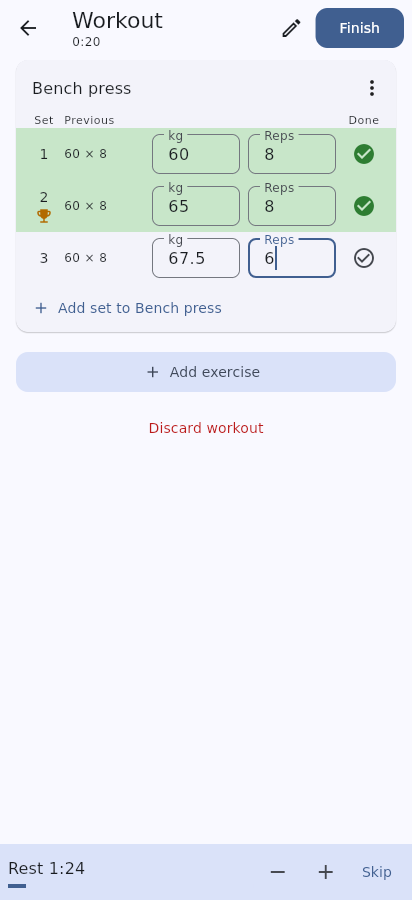
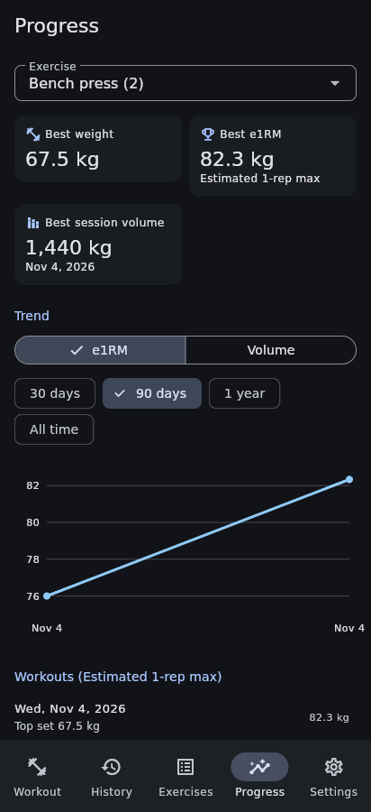
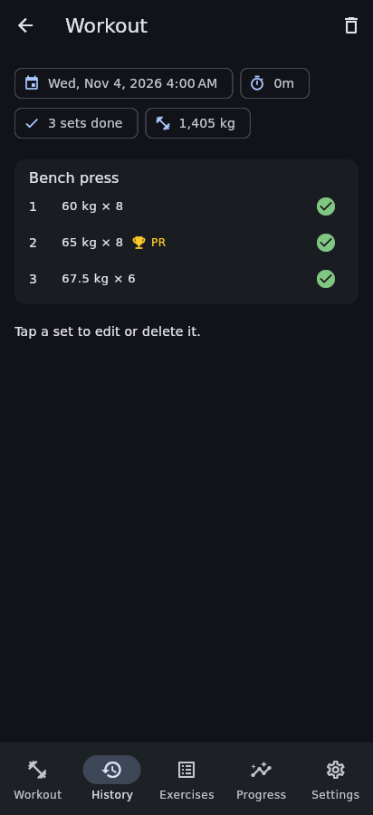
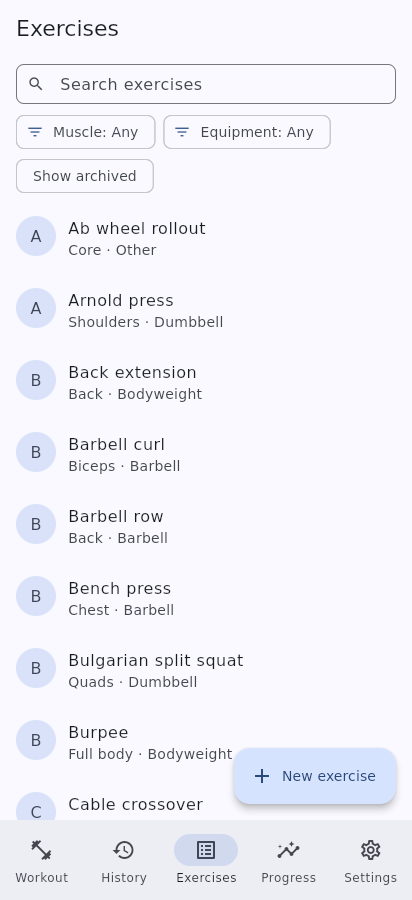
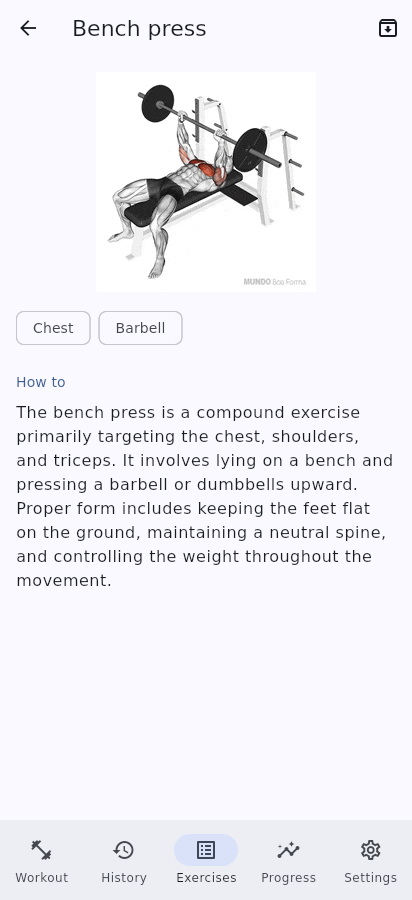
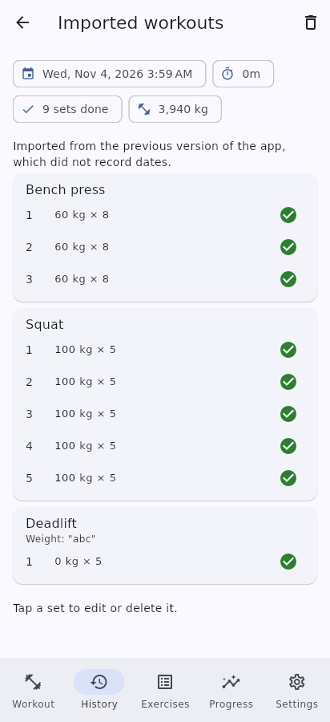

# Workout Tracker

A local-first strength-training logger for Android and iOS, built with Flutter. Log sets as
you lift, start workouts from routines, rest between sets, and watch your records go up.
No account, no server, no network: everything stays on your phone, and you can back it up
to a file whenever you like.

| Live workout | Progress (dark) | History (dark) |
|---|---|---|
|  |  |  |

| Exercise library | Exercise detail | Data imported from v1 |
|---|---|---|
|  |  |  |

*Screenshots are from the real app (Linux desktop build at phone size).*

## Features

- **Live workout logging.** Weight × reps per set with numeric keyboards and validation.
  Tick a set to complete it. Each set shows what you did last time, and new sets are
  prefilled from it. The workout is saved as you go and survives the app being killed.
- **Rest timer.** Starts automatically when you complete a set: the routine's rest for that
  exercise, otherwise your default. ±15 s and skip. It keeps correct time in the background.
- **Routines.** Save the exercises you repeat with target sets, reps and rest. Reorder by
  dragging, then start a workout from a routine with one tap.
- **Exercise library.** 65 common exercises seeded (the original five keep their animated
  demonstrations), plus search, filter by muscle group and equipment, and custom exercises.
  Exercises are archived, never deleted, so history stays intact.
- **History.** Every finished workout, newest first, loaded a page at a time. It shows
  date, duration, completed sets and volume. Open a workout to edit or delete sets.
- **Progress and personal records.** Per exercise: best weight, best estimated 1-rep max
  (Epley) and best session volume. A trend chart of e1RM or volume over 30 days / 90 days /
  1 year / all time. Record sets get a 🏆 PR badge, live and in history.
- **Units.** kg or lb. Storage is always kg; switching only changes the display.
- **Plate calculator.** Shows the plates to load on each side for a target weight, in kg or lb.
- **Backup.** Export everything to a versioned JSON file through the share sheet, and
  restore it later. A restore validates the file completely first and runs atomically, so a
  bad file never touches your data. You can also export every set as CSV for spreadsheets.
- **Light and dark themes** (or follow the system).
- **Accessible.** Labelled controls, tap targets of at least 48 dp, contrast-checked text,
  and layouts that work at 2× text size. All of these are enforced by tests.
- **Upgrading from v1** imports the old saved workouts automatically, once, without losing
  anything. Values that can't be parsed are kept as notes.

## Stack

| | |
|---|---|
| Flutter / Dart | 3.41.9 / 3.11.5 |
| State | flutter_riverpod 3 + riverpod_generator (code generation) |
| Navigation | go_router (named routes, `StatefulShellRoute` bottom navigation) |
| Database | drift (SQLite), schema v1 with migrations in place |
| Charts | fl_chart |
| Files | share_plus, file_picker, path_provider |
| Legacy | get_storage (read-only, for the one-time v1 import) |

Architecture, schema and every design decision are in
[docs/ARCHITECTURE.md](docs/ARCHITECTURE.md). The rules for contributing are in
[docs/RULEBOOK.md](docs/RULEBOOK.md).

## Run, test, build

```bash
flutter pub get
```

```bash
flutter analyze
```

```bash
flutter test
```

```bash
flutter run
```

After changing anything annotated with `@riverpod`, or any drift table or DAO, regenerate
the generated code and commit it with the source:

```bash
dart run build_runner build
```

## Project layout

```
lib/
  app.dart, main.dart       app root, themes, ProviderScope
  routes/                   go_router configuration (navigate by RouteNames only)
  data/                     drift database, tables, DAOs, seed, v1 import, backup codec
  src/<feature>/            model / view (+ view/widget) / viewmodel per feature:
                            startup, shell, workout, active_workout, history,
                            exercises, progress, settings
  common/widget/            shared UI components (state views, dialogs, toast)
  utils/                    design tokens, theme, units, training maths, clock
test/
  data/                     DAO, importer, seed, backup tests (in-memory SQLite)
  unit/                     pure logic (units, e1RM, rest timer, plates)
  widget/                   screen tests incl. accessibility and 2x text
```
